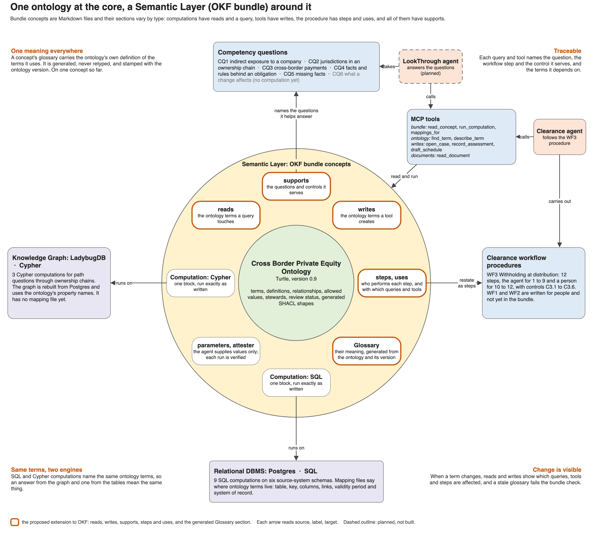

# Ontology-grounded AI agents for cross-border private equity

A prototype showing how one ontology and one semantic layer ground AI agents across two business products, over data held in emulated legacy systems. All fund, investor and payment data is synthetic, and the tax rules are illustrative.

**Status (2026-10-16):** business requirements and the semantic model are drafted. A first prototype exists for one procedure, WF3 withholding at distribution, with review screens and a documented extension to OKF that ties the bundle to the ontology. WF3 has been run with a grounded agent and an ungrounded one, on two distributions and two models:

- On the first distribution, D-001, both arms with Claude Opus are nearly always right: the grounded arm in 7 of 7 runs, the ungrounded arm in 5 of 6. The data is small and legible enough to read without the semantic layer.
- The second distribution, D-002, adds traps that only the semantic layer settles: a share-class code whose votes are waived by side letter, and two systems that disagree with only the mappings saying which wins. With Opus, the grounded arm was right in 3 of 3 runs and the ungrounded arm in 2 of 3; its miss under-withheld USD 50,000. With the smaller Claude Haiku, the grounded arm was right in 3 of 3 runs and the ungrounded arm in none.
- Grounded Haiku cost about USD 0.30 a run, about half the cost of ungrounded Opus. Every grounded line cites the facts and rules behind it, and the write tool refuses faulty drafts; the ungrounded arm leaves an answer with nothing behind it.

These are counts from three runs per arm and model, not rates. A read-only agent answers the six LookThrough questions from the same bundle. The reports are in [`solution/reports/`](solution/reports/); the latest is [D-002: traps only the semantic layer settles](solution/reports/2026-10-16-d002-traps-only-in-the-semantic-layer.md).

**Demo:** select the image for a two-minute captioned walkthrough of the review screens, [`solution/demo/xb-pei-demo.mp4`](solution/demo/xb-pei-demo.mp4). It has no sound. [`solution/demo/record.py`](solution/demo/record.py) records it again from the running app.

## Two products, one ontology, one semantic layer

| Product | What it does | Requirements |
|---|---|---|
| PEI LookThrough | Analytics: answers structure, payment and tax-obligation questions (CQ1–CQ6) about an investment that spans jurisdictions | [`business/lookthrough-product/lookthrough-business-product.md`](business/lookthrough-product/lookthrough-business-product.md) |
| PEI Clearance | Operations: investor tax onboarding, documentation upkeep, and withholding at distribution (WF1–WF3) | [`business/clearance-product/clearance-business-product.md`](business/clearance-product/clearance-business-product.md) |

Both products rest on the same two things:

- **The ontology** says what each term means: 38 concepts such as Party, Ownership Interest and Clearance, each with a steward and a status. It is in [`model/`](model/README.md).
- **The semantic layer** connects those terms to data and to work. Mappings say where each term's instances live in the source systems; attested queries, write tools and procedures refer to the terms through `reads` and `writes` links in their frontmatter. It is packaged as an OKF bundle in `solution/bundle/`.

Clearance runs on it for one procedure (WF3). LookThrough answers CQ1 to CQ6 on it, and CQ4 to CQ6 read what WF3 recorded.

## Repository layout

| Path | Contents |
|---|---|
| [`business/domain-narrative.md`](business/domain-narrative.md) | Domain background: fund, deal and company lifecycles |
| [`business/domain-glossary.md`](business/domain-glossary.md) | Acronyms |
| `business/lookthrough-product/` | LookThrough business requirements |
| `business/clearance-product/` | Clearance business requirements and three operating procedures (`wf1`–`wf3`), each with controls and scenarios |
| [`model/`](model/README.md) | The ontology, draft v0.11: OWL Turtle, stewardship and status per term, the Draw.io diagram (overview and five detail pages) with PNG renderings, and a README with decisions, traceability and checks |
| `solution/` | The prototype: emulated source systems and gold dataset, the OKF bundle, the graph projection, the agent runner and the run report |
| [`AGENTS.md`](AGENTS.md) | Modelling and Draw.io conventions for AI agents working in this repository |

## Where to start reviewing

1. The two business requirements documents, for scope and objectives.
2. [`model/README.md`](model/README.md), which shows each diagram page as an image; the editable source is `model/xb-pei-model.drawio` (diagrams.net). Pages 04 and 05 are the newest and least reviewed.
3. One operating procedure, for example [`wf3-withholding-at-distribution.md`](business/clearance-product/wf3-withholding-at-distribution.md), to see what the agents are expected to carry out.
4. The [first run report](solution/reports/2026-10-06-wf3-two-arm-run.md), for what the prototype does, and the [latest report](solution/reports/2026-10-16-d002-traps-only-in-the-semantic-layer.md), for where the two arms separate and what limits the conclusions.

## The prototype

Everything is under `solution/`. It covers WF3 and the LookThrough questions CQ1 to CQ6; WF1 and WF2 are not built.

| Path | Contents |
|---|---|
| `solution/db/` | Postgres schemas and seed data: six emulated source systems (entity management, investor register, onboarding, treasury, documents, rule library), the Clearance schema and the run log. Agents read the source systems and never write to them |
| `solution/gold/` | The answer key for the gold dataset and a script that recomputes its figures from the data |
| `solution/documents/` | Five synthetic documents |
| `solution/bundle/` | An [OKF v0.2](https://github.com/GoogleCloudPlatform/knowledge-catalog/blob/main/okf/SPEC.md) bundle: the WF3 procedure, nineteen attested computations, five tools, and the mapping files that say where instances of each ontology term live |
| `solution/shapes/` | SHACL shapes generated from the ontology, and hand-written shapes for four procedure controls |
| `solution/xbpei/` | Python: ontology and mapping lookups, checks, the graph projection (LadybugDB), the executor and attester, the write tools, the two agent runners (`agent` for WF3, `ask` for LookThrough questions), the scorer and the reviewer measures |
| `solution/app.py` | A Streamlit app with six pages. **Overview**: the results on record, and one term followed from the procedure step and question that need it, through its meaning and mappings, to the SQL and Cypher that read it and the rows they return. **Clearance workflow**: the WF3 steps with who performs each, the draft schedule, the evidence behind each line and reviewer sign-off. **LookThrough analytics**: ask a question live, see where the answer sits in the structure graph, its figures and what it rests on. **Run replay**, **Benchmark** with the reviewer measures, and **Ontology**: the term browser, the model diagrams, the Turtle and the governance table. The workflow, analytics and ontology pages carry their requirements, bundle files and other sources as tabs, and a file named on a page opens over it |
| `solution/reports/` | The run reports and the exported runs |

How the pieces relate:

- **The ontology says what a term means, a mapping says where its instances live, and a query retrieves them.** These are three separate artifacts. Nothing translates ontology terms into SQL automatically.
- **The bundle refers to the ontology.** The frontmatter keys `reads` and `writes` name the ontology terms each computation and tool depends on, and procedure steps name the concepts they use. Every computation and tool carries a `# Glossary` section for those terms: their meaning from the ontology, where they live in the data from the mappings, and the ontology version. It is generated, and `bundle check` fails when it is out of date.
- **Reads are attested computations.** An agent supplies values for declared parameters; it does not write or change the query. Each run is checked against the bundle.
- **Writes are tools.** Agents add drafts to the Clearance schema after the draft passes the shapes. Only a person signs a schedule, under a separate database role.
- **The graph is a read-only projection** rebuilt from Postgres. Its schema is written by hand, not generated from the ontology; a mapping file of its own says which node, edge or property holds each term, and `check_mappings` tests it against the schema.

How the bundle ties the questions, the workflow and the data to one ontology. The source is [`solution/okf-extension-overview.drawio`](solution/okf-extension-overview.drawio); regenerate the image with `python diagrams/render.py okf-extension-overview` from `solution/` when it changes. The extension to OKF that it shows is described in [`solution/okf-ontology-grounding-extension.md`](solution/okf-ontology-grounding-extension.md).

To run it, see section 12 of the [first run report](solution/reports/2026-10-06-wf3-two-arm-run.md). To ask a LookThrough question, run `.venv/bin/python -m xbpei.ask Q1` from `solution/`, or pass a question in quotes. `.venv/bin/python -m xbpei.measures` prints the reviewer measures. To open the review screens, run `.venv/bin/streamlit run app.py` from `solution/` with the database up. The pages read the live database, so they are empty until an agent run has been recorded. Asking a question on the LookThrough page runs the agent, which needs a Claude Code login or an API key, takes about 10 to 40 seconds and costs a few cents. The structure graph loads its drawing library from the network. A page can be opened by link, for example `?page=LookThrough analytics`.

## Demo Video
https://github.com/user-attachments/assets/065f742b-c24f-4f44-a226-d878afe5af0d

## Roadmap

What comes next, and the questions still open, are in [`ROADMAP.md`](ROADMAP.md). The first phase is a larger and more realistic synthetic dataset, so that the benchmark separates the two arms at scale and not only on hand-set traps.

## Sources and licence

The domain background draws on the Coursera course [*Private Equity and Venture Capital*](https://www.coursera.org/learn/private-equity) (Università Bocconi), cited by week and page. The course slides are not included in this repository.

Copyright 2026 Radu Marian. Licensed under the [Apache License 2.0](LICENSE).

## Limits

The operating procedures are illustrative and have not been reviewed by a practitioner. The ontology encodes no jurisdiction-specific tax rule. The three rule versions in the prototype's rule library are illustrative. The treaty rates, the 10 percent voting threshold and the 30 percent statutory rate were read in the 1996 convention and the Code on 2026-10-09; nothing else in them has been checked, the 2009 protocol was not read, and the prototype applies the threshold to an indirect holding where the convention says a direct one. The Turtle parses with rdflib and has not been run through a reasoner. The bundle's concepts are drafts and none has been verified by a person. Each arm has been run three to seven times per distribution and model, and each LookThrough question once. The traps were written by the same hand as the semantic layer that settles them. The write tool checks the total gross amount per component, not each line's share.
