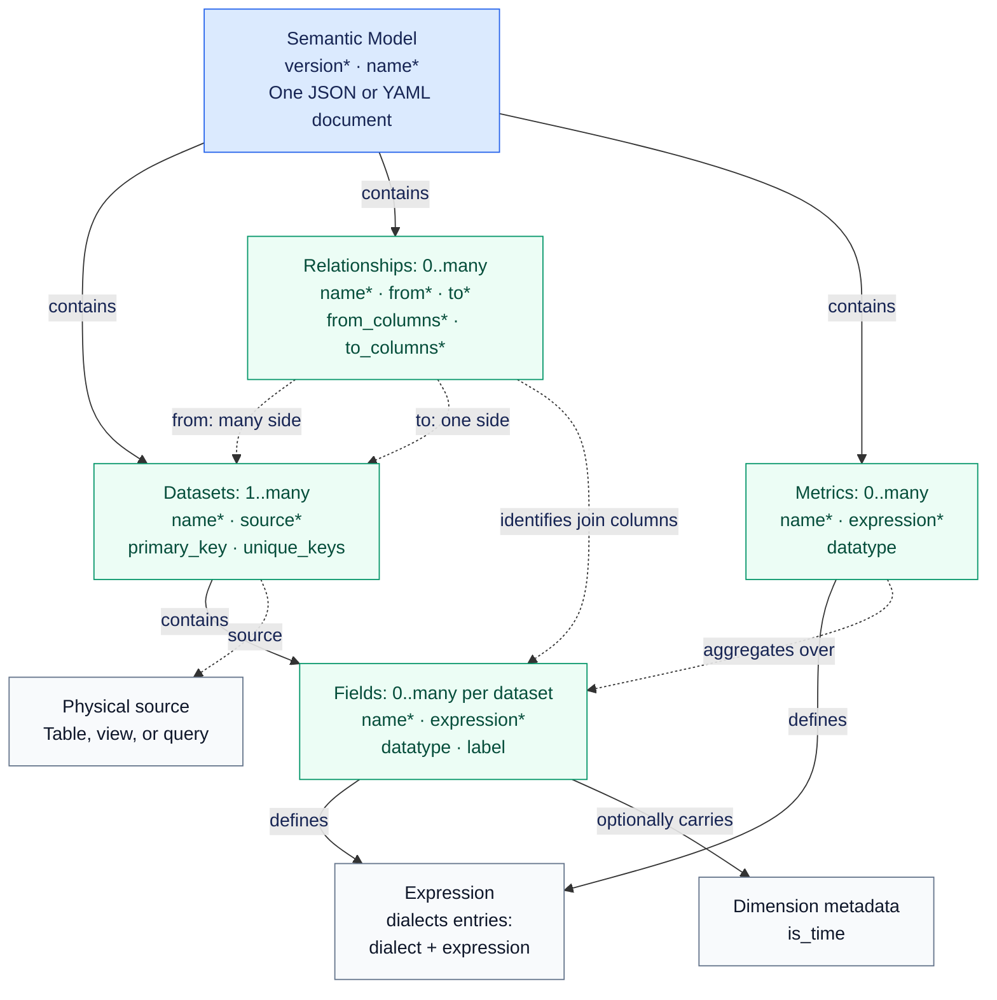

# OKF and OSSIE: comparison and value for agentic projects

Date: 2026-10-09  
Status: architecture research note; OSSIE adoption is a proposal, not an implemented feature.

## Main point

Google Cloud's Open Knowledge Format (OKF) packages knowledge for humans and agents. Apache OSSIE standardizes analytical semantic models for AI and BI tools. Their overlap is data context, but their interoperability targets differ: OKF makes knowledge portable and navigable; OSSIE makes analytical definitions explicit and exchangeable.

For this project, OKF already packages the ontology-grounded computations, tools, and procedure. OSSIE could add a structured analytical contract for selected LookThrough datasets and metrics. It would complement the existing ontology, mappings, and execution controls rather than automatically replacing them.

## Specifications compared

- [OKF v0.2 specification](https://github.com/GoogleCloudPlatform/open-knowledge-format/blob/main/SPEC.md).
- [OSSIE core metadata specification](https://github.com/apache/ossie/blob/main/core-spec/spec.md), version `0.2.0.dev0` when reviewed. This is an unreleased, mutable draft; its version history advises against depending on that development version in production.

These links point to moving branches. Pin revisions before implementing compatibility. The comparison concerns the linked OSSIE **core** specification; it is not an assessment of all adjacent OSSIE ontology or execution specifications.

## Comparison

| Aspect | OKF | OSSIE core |
|---|---|---|
| Purpose | Represent metadata, context, and curated knowledge | Standardize analytical semantic model definitions |
| Scope | Tables, datasets, metrics, APIs, processes, playbooks, references, and other producer-defined concepts | Datasets, fields, relationships, and metrics |
| Representation | Directory of Markdown documents with YAML frontmatter | One semantic model per JSON or YAML document |
| Minimum structure | `type` is the only always-required concept frontmatter key; specialized types can add requirements | Model requires `version`, `name`, and a nonempty `datasets` array; entities have further required properties |
| Relationships | Markdown links; their meaning comes from surrounding prose | Explicit dataset relationships with corresponding foreign-key and target-key columns |
| Metrics | Metric concepts can describe meaning and link to sanctioned computations | Metrics carry aggregate expressions with declared dialects |
| Types | Concept type names are producer-defined, with unknown types tolerated | Defined analytical entity structures and logical datatype vocabulary |
| Provenance and trust | Standard fields for sources, generation, verification, lifecycle, and staleness | No equivalent standard trust/lifecycle fields in the linked core spec |
| Extensions | Additional frontmatter keys; consumers must tolerate unknown fields | Vendor-named `custom_extensions` containing JSON data |
| Distribution | Knowledge bundles, optional indexes, and update logs | Core excludes bundle formats and cross-model references |
| Execution | Describes computation and attestation contracts; does not execute them itself | Declares analytical definitions; listing a dialect does not guarantee a consumer can execute it |

Both aim at portability and interoperability, use text formats suitable for version control, and accommodate human descriptions and AI context. Their key tradeoff is generality versus explicit analytical structure.

OKF can explain why Finance excludes a category from revenue, who reviewed that policy, and when the concept becomes stale. OSSIE can represent the datasets, fields, join keys, and calculation expression. Merely describing a join in OKF does not provide the same machine-readable analytical contract as an OSSIE relationship.

## Does OKF have a Playbook concept?

Yes, with a qualification. [Section 4.1](https://github.com/GoogleCloudPlatform/open-knowledge-format/blob/main/SPEC.md#41-frontmatter) explicitly lists `Playbook` among example type values. Section 4.4 includes a `type: Playbook` example for an incident-response data freshness alert, with `# Trigger` and `# Steps` in its body.

However, OKF does **not** define a dedicated Playbook schema, a fixed taxonomy, or workflow execution semantics. A playbook is an ordinary concept whose producer chooses the type name and body structure. Thus, “supports playbooks as concepts” is accurate; “defines a formal playbook workflow model” would be inaccurate.

In this project's bundle, the `Procedure` type and structured `steps`, `performed_by`, `uses`, and `supports` fields are project conventions described in the [ontology-grounding extension](okf-ontology-grounding-extension.md). They are not requirements of the base OKF spec.

## OSSIE core model diagram

The following preserves the explanatory schema diagram from the discussion. It documents the external OSSIE document structure; it is not a proposed change to the project's domain ontology or Draw.io model. Solid arrows show containment and dotted arrows show references. Asterisks mark required properties.

Metrics belong to the model and can span datasets. Fields belong to individual datasets. Models, datasets, relationships, fields, and metrics support optional `ai_context` and `custom_extensions`. Dataset relationship column arrays pair in order and must have matching lengths. `datatype` describes value type; `dimension.is_time` describes temporal role.

Only `OSSIE_SQL_2026` has semantics defined by OSSIE in the linked spec's dialect discussion. Other listed dialects identify vendor or third-party languages: their expressions are opaque to OSSIE and implementations may ignore them. Multi-dialect declarations therefore do not imply universal executable portability.

## Value for an agentic project

| Agent need | OKF value | OSSIE value |
|---|---|---|
| Understand context | Packages policies, explanations, examples, and procedures | Associates descriptions, synonyms, and instructions with analytical entities |
| Discover relevant information | Indexes and links support progressive discovery | Structured datasets, fields, and relationships expose the analytical model |
| Calculate consistently | Links to sanctioned computations and their execution evidence contracts | Defines metric expressions, sources, and join keys |
| Assess reliability | Records sources, verification, and staleness signals | Supplies structured definitions consumers can validate |
| Change tools or models | Knowledge travels as Markdown bundles | Analytical definitions travel as JSON/YAML |

For an agent answering “Why did revenue fall last month?”, OKF could surface the recognition policy, business events, pipeline issues, and their freshness. OSSIE could supply the revenue formula, source datasets, date fields, and joins. This is a proposed architecture, not a built-in integration between the standards.

Your application still retrieves context, applies permissions, selects an execution engine, runs queries, and validates results. Neither format guarantees correctness, completeness, or safe tool execution.

### OKF attested computations

[Section 10](https://github.com/GoogleCloudPlatform/open-knowledge-format/blob/main/SPEC.md#10-attested-computations-concept) defines optional `Attested Computation` concepts. Their contracts can name:

- A runtime and typed parameters.
- An inline computation or referenced computation file.
- An executor and the receipt fields a run returns.
- Deterministic attester code that evaluates the receipt.

This makes OKF more than a documentation convention: it can record a sanctioned computation and how a consumer checks evidence that it was executed. It does not supply the executor or attester implementation, nor does the format itself execute code. Trust tiers are advisory signals, not access control.

## Application to Cross Border Private Equity Investment

### Existing project architecture

According to the [project README](../README.md) and [ontology-grounding extension](okf-ontology-grounding-extension.md), the prototype already separates:

1. **Business requirements:** LookThrough questions and Clearance procedures/controls.
2. **Domain ontology:** OWL Turtle definitions, stewardship, and term status under `../model/`.
3. **Mappings:** Locations of ontology terms in source systems and the graph projection.
4. **OKF bundle:** Computations, tools, and the WF3 procedure under `bundle/`.
5. **Application execution:** Query execution, attestation, write tools, checks, and human sign-off.

The repository documents WF3 and LookThrough CQ1–CQ3 as implemented, with WF1, WF2, and CQ4–CQ6 outstanding. This note records that documented state; it does not independently rerun or validate the prototype.

The project-specific extension adds `reads`, `writes`, `supports`, procedure `steps`, generated glossaries, mapping files, and an ontology declaration. Those additions provide ontology grounding and traceability beyond base OKF. Existing source-to-ontology mappings are not automatically OSSIE models.

### What OSSIE could add

For LookThrough, selected relational datasets and reusable aggregate metrics could be represented in OSSIE, providing an explicit exchange contract for analytical consumers. An OKF concept could reference that definition while retaining explanations, provenance, workflow context, and sanctioned execution instructions.

OSSIE core alone does not establish equivalent semantics for the project's OWL axioms, Cypher ownership traversals, procedural controls, write operations, or sign-off workflow. Replacing the existing layer wholesale would require examining these gaps and consumer capabilities.

For Clearance, OKF plus the project's ontology extension already represents the relevant procedure, sanctioned reads, and controlled writes. OSSIE's likely incremental role would be selected analytical definitions feeding the workflow, rather than defining the workflow itself.

A synthetic example is asking who is entitled to a proposed distribution and how the amount is allocated. OKF could guide the agent through the approved procedure and expose supporting computations. OSSIE could potentially define relational fields, joins, and reusable aggregate measures. The ontology and existing mappings would still define business meaning and how ownership evidence is represented; the runtime would still execute and attest computations. This is a design illustration, not a claim that an OSSIE implementation exists or that the calculation is legally sufficient.

## Recommendation and integration boundaries

Continue using OKF for the existing agent-facing knowledge and execution contracts. Evaluate OSSIE when there is a concrete need to exchange analytical models with a BI or AI consumer, or to reuse consistent dataset and metric definitions across tools.

A scoped evaluation could select one LookThrough question, represent its relational datasets and any applicable aggregate metric in a pinned OSSIE version, reference it from an OKF concept, and check that the intended consumer produces the same result as the existing sanctioned computation. Identify one authoritative definition for each calculation so separately maintained copies do not drift.

This integration pattern is a recommendation; no standardized OKF-to-OSSIE mapping was established in this review. OSSIE-to-OKF documentation generation is straightforward in principle, but reversing arbitrary OKF documents into OSSIE requires modeling decisions because prose may omit exact types, joins, or calculation semantics.

Neither standard replaces the domain ontology. Neither removes the need for authoritative content, freshness management, access controls, execution checks, or human review where the workflow requires it.

## Sources and related project documents

- [Canonical OKF v0.2 specification](https://github.com/GoogleCloudPlatform/open-knowledge-format/blob/main/SPEC.md).
- [OSSIE core specification and version history](https://github.com/apache/ossie/blob/main/core-spec/spec.md).
- [Project overview](../README.md).
- [OKF ontology-grounding extension](okf-ontology-grounding-extension.md).
- [Domain ontology and modeling decisions](../model/README.md).
- [Existing OKF bundle index](bundle/index.md).

The comparison and Playbook clarification are based on the linked specifications reviewed in this discussion. The project recommendations are architectural judgments, not requirements of either standard.
